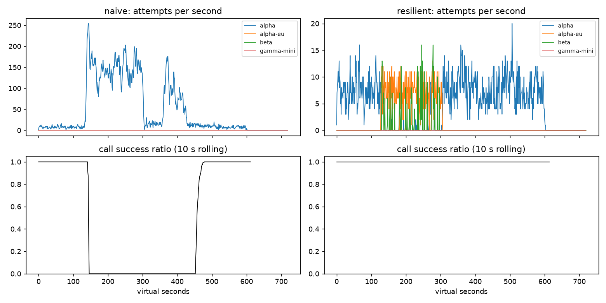

# Lab 25B — Report

**Họ tên / nhóm:** Nguy Khac Phi Long — MSV 2A202602532  **Commit:** `b66e06d`  **Điểm tự động (`make grade`):** 84 / 88 (4 điểm còn lại là dữ liệu SLO ẩn của giảng viên)

> Mọi số dưới đây lấy từ `reports/gameday/*.json`, `reports/cache/*.json`, `reports/workflows.json`, `reports/slo.json`
> (seed 25, config cuối cùng trong `configs/gameday.yaml`). Ngoài seed 25, client đã được chạy thêm trên seed
> 25, 26, 27, 1–5 và trên 4 biến thể/băng (lệch thời điểm ±40 s, cường độ ×0,6–1,4): 6/6 băng + C1 PASS ở mọi lần chạy.

## 1. Kết quả Game Day (naive vs của bạn)

| Băng | Client | availability | p95 (s) | amplification | retry_ratio | cost/turn | recovery (s) | PASS? |
|---|---|---:|---:|---:|---:|---:|---:|:---:|
| G1 | naive | 0,7194 | 7,157 | 7,738 | 6,738 | 2,163 | 4 | ❌ (36 027 vi phạm retry-after) |
| G1 | yours | 1,0000 | 4,809 | 1,065 | 0,002 | 2,107 | 0 | ✅ (0 vi phạm) |
| G2 | naive | 0,4560 | 15,034 | 9,904 | 8,904 | 4,627 | 155 | ❌ |
| G2 | yours | 1,0000 | 5,140 | 1,029 | 0,006 | 2,104 | 0 | ✅ (primary share 1,00) |
| G3 | naive | 1,0000 | 4,768 | 1,164 | 0,164 | 2,328 | 0 | ❌ (retry_ratio) |
| G3 | yours | 1,0000 | 4,837 | 1,032 | 0,015 | 2,105 | 0 | ✅ |
| G4 | naive | 1,0000 | 13,764 | 1,004 | 0,004 | 2,008 | 0 | ❌ (p95) |
| G4 | yours | 1,0000 | 5,189 | 1,028 | 0,004 | 2,104 | 0 | ✅ (primary share 1,00) |
| G5 | naive | 0,3699 | 5,359 | 17,030 | 16,030 | 2,124 | – | ❌ (9 149 retry trên lỗi 400) |
| G5 | yours | 0,8179 | 5,471 | 1,004 | 0,003 | 2,505 | – | ✅ (0 retry 400, 0 failover thừa) |
| G6 | naive | 0,5170 | 4,836 | 12,344 | 11,344 | 2,009 | 0 | ❌ |
| G6 | yours | 1,0000 | 5,877 | 1,050 | 0,025 | 2,196 | 0 | ✅ (0 incompatible route) |

Ghi chú: ở G5, toàn bộ 413 lượt thất bại của client mình là `client_error`, tức request malformed do bad deploy. Không client nào cứu được những lượt này, nên 0,818 là mức trần thực tế. Chi phí/lượt ở G5 cao hơn (2,505) vì sau khi account A hết quota, traffic phải chạy trên `beta` (giá 1,4).

## 2. Cấu hình client và lý do

| Tham số | Giá trị | Vì sao (dựa trên băng nào, số liệu nào) |
|---|---:|---|
| attempt_timeout_s | 5,0 | Bình thường một attempt mất ~1,2–1,8 s (p99 lượt ~5,7 s cho **2** call), nên 5 s ≈ 2–3× p99 một attempt. Như vậy vẫn còn chỗ cho alpha → alpha-eu → beta trong deadline 30 s. Quét trên G2: timeout 3/5/8/12 cho p95 = 5,19/**5,14**/5,86/5,98 s. Timeout 3 bắt đầu cắt cả request khỏe (G6: 3 lượt `no_provider_available`, retry_ratio 0,055 so với 0,025). Timeout 12 làm G6 có 2 lượt `deadline`. Timeout 30 làm G6 tụt còn 0,9505 (xem thí nghiệm 2). |
| max_attempts_per_provider | 2 | Tức 1 retry trên cùng provider, sau đó fail over. Ở G3 (30% lỗi 500 ngẫu nhiên), retry 1 lần là đủ: 0,7 → 0,91 thành công. Quét G3: max 1/2/3 → retry_ratio 0/0,015/0,019, availability đều 1,0. Giá trị 1 làm mất khả năng tự chữa lỗi 500 lẻ tẻ nên phải fail over sang alpha-eu, primary share chỉ còn 0,996. Giá trị 3 tốn thêm retry mà không cải thiện gì. |
| backoff_base_s / cap_s | 0,25 / 4,0 | Full jitter nên các retry không dồn về cùng một thời điểm. Base nhỏ vì lỗi 500/529 thường thoáng qua. Cap 4 s giữ retry nằm gọn trong deadline. Quét G1/G2 với 1,0/8,0: p95 G2 tăng 5,14 → 5,22 s, amplification gần như không đổi (1,029 → 1,030). Base lớn không đem lại gì thêm vì breaker và budget đã chặn storm. |
| retry_budget_ratio | 0,1 (min 0,5/s, max 20 token) | Retry tối đa ~10% so với số first attempt. G3 đạt retry_ratio 0,015 (giới hạn 0,10). Thí nghiệm 1 cho thấy khi breaker hỏng, chính budget giữ G3 ở retry_ratio 0,068 (PASS); không có budget thì lên 0,158 (FAIL). |
| breaker.window_size / min_calls | 20 / 10 | Mức tải ~8 call/s nên 20 kết quả ≈ 2–3 s dữ liệu: phản ứng nhanh mà không nhạy với vài lỗi lẻ. min_calls 10 chống việc trip vì 2 lỗi lúc vắng tải. Quét G2: (10,5) → p95 5,12 s nhưng 9 call bị đẩy xuống gamma-mini (dao động nhiều hơn). (100,50) → amplification 1,033 và 14 call xuống gamma-mini. (20,10) cho 0 call gamma-mini với p95 5,14 s. |
| breaker.failure_rate_threshold | 0,5 | G3 có 30% lỗi 500, ngưỡng 0,5 nên breaker không trip vì brown-out nhẹ. Retry đã đủ xử lý, và alpha vẫn gánh 2 389 attempt. Với 0,8: G3 retry_ratio 0,068 (gấp 4,5 lần), amplification 1,136. Với 0,3: breaker trip sớm, G3 retry_ratio 0,005 nhưng G2 p95 tăng lên 6,58 s vì breaker trip/đóng liên tục. 0,5 cân bằng được cả hai băng. |
| breaker.slow_call_s | 5,0 | G4 cộng thêm 5 s, nên call alpha mất ≥ 6,2 s, bị coi là chậm. Lượt bình thường p99 ~5,7 s cho 2 call (~2,9 s/call), nên 5 s không bắt nhầm call khỏe. Với timeout 5 s, call G4 thường bị timeout trước khi vào nhánh slow. Đo với timeout 8 s, nơi slow-call là lớp duy nhất: slow_call 5 → p95 5,68 s (PASS); slow_call 8 hoặc 100 → p95 **13,77 s (FAIL)**, toàn bộ 4 366 attempt dồn vào alpha. |
| breaker.open_duration_s | 30,0 | Mỗi lần HALF-OPEN là vài probe gửi vào một alpha đang ngập hàng đợi. Quét G2: 5/10/30 s → p95 8,86/6,08/**5,14** s, số call bị đẩy xuống gamma-mini 20/0/0. Khi alpha đã hồi phục, 30 s vẫn đủ ngắn để quay lại: primary share sau restore là 1,00 ở G2, G4, G6. |
| breaker.half_open_max_probes | 2 | Quét G2: 1/2/10 probe → p95 5,28/5,14/8,90 s. Với 10 probe, ta tự tạo "thundering herd" vào provider đang hồi phục: amplification 1,068 so với 1,029. Với 1 probe, quá trình đóng lại chậm hơn (7 call xuống gamma-mini). |

Sơ đồ quyết định của `on_error` (một tầng retry duy nhất, cooldown dùng chung cho mọi call):

```
classify(err)
 ├─ CLIENT_ERROR (400/401/422)  → breaker.release  → GiveUp("client_error")   (không retry, không failover)
 ├─ QUOTA_EXHAUSTED (429 quota) → breaker.release  → cooldown provider 300 s → failover ngay (delay 0)
 ├─ RATE_LIMITED (429 + RA)     → breaker.release  → cooldown = now + retry_after → failover ngay
 │                                                    (hết ladder: chờ cooldown ngắn ≤ 5 s + jitter nếu còn kịp deadline)
 └─ OVERLOADED / SERVER_ERROR / TIMEOUT → breaker.on_failure
        tries < 2  AND breaker != OPEN AND kịp deadline AND budget.try_acquire_retry()
             ├─ có → retry CÙNG provider sau FullJitter(tries)
             └─ không → failover sang provider kế tiếp (delay 0)
_route(): bỏ qua provider đang cooldown hoặc breaker từ chối; ladder("tool") = [alpha, alpha-eu, beta] (không gamma-mini)
```

## 3. Ba thí nghiệm

1. **Retry budget là lớp phòng thủ cuối.** Cho breaker hỏng (`min_calls: 1e9`) và `max_attempts_per_provider: 5`:

   | Băng | Cấu hình | amplification | retry_ratio | recovery (s) | availability | PASS |
   |---|---|---:|---:|---:|---:|:---:|
   | G2 | breaker hỏng + **có** budget | 1,409 | 0,061 | 0 | 0,9996 | ✅ |
   | G2 | breaker hỏng + **không** budget | 1,686 | 0,444 | 38 | 0,9793 | ❌ ampl, recovery |
   | G3 | breaker hỏng + **có** budget | 1,136 | 0,068 | 0 | 1,0 | ✅ |
   | G3 | breaker hỏng + **không** budget | 1,162 | 0,158 | 0 | 1,0 | ❌ retry_ratio |
   | G2 / G3 | breaker tốt, không budget | 1,029 / 1,032 | 0,006 / 0,015 | 0 / 0 | 1,0 / 1,0 | ✅ |

   Khi breaker hỏng, mỗi call được retry tới 4 lần vào alpha đang ngập. Budget (token bucket 10%) chặn tổng số retry
   *của cả hệ thống*, bất kể từng call muốn bao nhiêu. Vì vậy retry_ratio ở G2 giảm từ 0,444 xuống 0,061 và hệ thống
   không rơi vào vòng metastable (recovery 0 s so với 38 s). Khi breaker hoạt động đúng, budget gần như không bị chạm tới:
   số liệu giống hệt nhau (1,029 / 0,006), vì breaker đã fail fast trước khi retry kịp dồn lên. Nên vẫn giữ cả hai vì chúng
   bảo vệ ở hai trục khác nhau. Breaker xét sức khỏe *từng provider* và cần đủ `min_calls`, cấu hình đúng. Budget là giới
   hạn *toàn cục*, không phụ thuộc cấu hình breaker, nên vẫn giữ được khi breaker sai cấu hình, khi lỗi rải đều trên nhiều
   provider, hoặc khi lỗi nằm dưới ngưỡng trip (G3: 30% < 50%).

2. **`attempt_timeout_s: 30`.**

   | Băng | timeout | availability | give_up_reasons | p95 (s) |
   |---|---:|---:|---|---:|
   | G6 | 5 (của mình) | 1,0000 | {} | 5,877 |
   | G6 | 30 | **0,9505** | `deadline: 101`, `no_provider_available: 17` | 5,359 |
   | G4 | 5 | 1,0000 | {} | 5,189 |
   | G4 | 30 | 1,0000 | {} | 5,262 |

   Ở G6, `alpha-eu` treo không trả lời. Với timeout 30 s, call nào rơi vào alpha-eu sẽ chờ hết **toàn bộ** deadline 30 s
   của user rồi mới được biết là thất bại. Không còn thời gian để fail over sang beta, nên có 101 lượt `deadline`.
   Availability giảm 5 điểm phần trăm (sát ngưỡng 0,95), trong khi p95 lại *giảm* (5,88 → 5,36 s). Đó là survivorship
   bias: các lượt chậm nhất đã chết và không được tính vào p95. G4 gần như không đổi vì alpha ở G4 vẫn trả lời, chỉ chậm
   (~6,2 s). Ở đây slow-call detection của breaker mới là cơ chế làm việc, timeout thì không: sau vài call chậm, breaker
   mở và traffic chuyển sang alpha-eu. Timeout "đúng" phải tính *ngược từ deadline của user*: cần đủ chỗ cho ít nhất 2
   lần fail over (3 × 5 s + backoff < 30 s), đồng thời lớn hơn p99 của một attempt bình thường (~3 s) để không cắt nhầm
   request khỏe.

3. **Bỏ lọc tool calling khỏi `ladder()`.** G6: `incompatible_routes = 249` (từ 0), availability 1,0 → **0,8956** (FAIL).
   Cả 249 lỗi đều là `incompatible_model_output`. Nói theo ngôn ngữ product: *khi nhà cung cấp chính sập, cứ khoảng 10
   khách hàng yêu cầu hoàn tiền thì 1 người nhận được câu trả lời "đã xử lý" từ một model không có khả năng gọi công cụ
   hoàn tiền. Thực tế không có gì được tra cứu hay hoàn tiền cả.* Đó là lỗi im lặng còn tệ hơn báo lỗi: hệ thống tưởng
   đã thành công, khách tưởng đã xong, và vấn đề chỉ lộ ra khi khách gọi lại tổng đài. Fallback sang model rẻ chỉ hợp lệ
   cho bước `chat`. Trong G6 có 424 call chat đi gamma-mini một cách hợp lệ.

## 4. Workflow hoàn tiền

| Executor | completion | crashes | duplicate refunds | duplicate emails | lost refunds | overpaid | wasted LLM / crash |
|---|---:|---:|---:|---:|---:|---:|---:|
| naive | 100% | 81 | 128 | 81 | 0 | 14 967,00 (1 496 700 cent) | 1,123 |
| yours | 100% | 66 | **0** | **0** | **0** | 0 | **0,303** |

- **Chỉ có idempotency key là chưa đủ.** Key ngăn *trả tiền hai lần*, nhưng worker mới không có trí nhớ nên vẫn phải
  chạy lại từ đầu: gọi lại LLM `classify` (tốn tiền), lookup lại, gọi lại payment. Các lần gọi lại này chỉ vô hại nhờ key.
  Wasted LLM/crash sẽ ≈ 1,1 như naive, và mỗi bước không có key (ví dụ một API bên thứ ba không hỗ trợ key) sẽ chạy lại thật.
- **Chỉ có checkpoint cũng chưa đủ.** Checkpoint ghi *sau* khi step trả về. Nếu worker chết ngay sau khi payment đã
  commit nhưng trước khi ghi checkpoint (`WorkerCrash` ~4%), hoặc response bị mất (`ServiceTimeout` ~10%), worker mới
  không thấy checkpoint và gọi refund lại. Không có key cố định theo (session, step) thì mỗi lần như vậy là hoàn tiền thêm
  một lần. Naive có 128 lượt hoàn trùng, tức trả thừa 14 967.
- **Ghi checkpoint *trước* khi gọi payment:** nếu worker chết giữa lúc ghi checkpoint và lúc payment thực thi, worker mới
  thấy checkpoint "đã xong" và bỏ qua bước đó. Kết quả là **hoàn tiền bị mất** (khách không bao giờ nhận được tiền), và
  bước `send_email` còn gửi xác nhận cho một khoản hoàn không tồn tại. Thứ tự đúng là: thực thi (với idempotency key ổn
  định) → thành công → checkpoint. Crash ở bất kỳ điểm nào cũng chỉ dẫn tới "chạy lại một step vô hại".

## 5. Alerting & error budget

| Sự cố | Mong đợi | Naive alerter (5 phút > 5%) | Burn-rate alerter | Độ trễ phát hiện (burn-rate) |
|---|---|---|---|---:|
| checkout_bug | page | page (1 phút) | page ✅ | 27 phút (hạn 35) |
| provider_outage | page | page (0 phút) | page ✅ | 4 phút (hạn 8) |
| deploy_blip | none | **page (false)** | none ✅ | – |
| slow_leak | ticket | **không phát hiện** | ticket ✅ (không page) | 1 337 phút (hạn 1 800) |
| degraded_evening | page | page (214 phút) | page ✅ | 291 phút (hạn 330) |
| night_spike | none | **page (false)** | none ✅ | – |
| small_bump | none | **page (false)** | none ✅ | – |

Naive: 7 page, 3 false page, bỏ sót slow_leak. Burn-rate: 3 page, 1 ticket, 0 false page.

**Error budget 30 ngày:** 25 901 755 request, cho phép 129 508,8 lỗi (0,5%), thực tế 55 618 lỗi (availability 99,7853%).
Đã tiêu **42,95%**, còn **57,05%**. **Không** đóng băng release (`freeze_releases = False`). Tuy nhiên slow_leak âm thầm
ăn budget trong 2 ngày, nên ticket đó cần được xử lý trong giờ làm việc.

**Vì sao `small_bump` (20 phút ở 12% lỗi) không nên đánh thức ai?** Nó đốt budget ở burn rate 0,12/0,005 = 24×, nhưng
chỉ trong 20 phút: 20/43 200 × 24 ≈ **1,1% budget tháng**. Rule page nhanh cần burn ≥ 14,4× suốt **1 giờ** (≈ 2% budget).
Trung bình 1h của bump chỉ là 24 × 20/60 = 8× < 14,4, nên đúng là không page. Mất ~1% budget là chuyện cần xem trong
giờ làm việc hoặc postmortem, không đáng gọi on-call ra khỏi giường. Page phải dành cho những gì đe dọa SLO. Nếu page vì
mọi gợn sóng thì on-call sẽ nhờn với page (alert fatigue) và bỏ lỡ sự cố thật.

## 6. Postmortem — Băng G2 với client naive (blameless)

*Nguồn: `reports/gameday/G2_overload_storm.png`, `reports/gameday/naive_G2_overload_storm_timeseries.csv`, `reports/gameday/naive.json`.*



**Tóm tắt:** Lúc t=120, `alpha` mất 75% GPU trong 3 phút. Client v1 có 3 tầng retry chồng nhau (tối đa 36 attempt/call,
delay cố định 0,2 s, không jitter, không breaker, không fallback). Nó khuếch đại tải lên alpha từ ~7,5 lên ~150 attempt/s,
và tỷ lệ thành công rơi về 0 suốt **5,5 phút** (t≈145 → t≈453). Vùng sập kéo dài **153 s sau khi alpha đã hồi phục hoàn
toàn** lúc t=300: lỗi phần cứng 3 phút trở thành sự cố người dùng 5,5 phút, kiểu metastable failure.

**Ảnh hưởng:** 1 285 / 2 362 lượt user thất bại (availability 45,6%), recovery_s = 155 s. Có 34 475 attempt cho 3 481
logical call (amplification 9,9×), cost/lượt thành công 4,63 (gấp 2,2 lần bình thường ~2,1). Theo SLO 99,5%/30 ngày ở
4 lượt/s, tháng có ~10,37 triệu lượt và budget là ~51 840 lượt lỗi. Riêng sự cố này đã tiêu **~2,5% budget tháng** trong
10 phút. Nếu cùng mức độ kéo dài 1 giờ, nó sẽ tiêu ~16% budget.

**Timeline** (giây ảo, cửa sổ trung bình 30 s từ CSV):

| t | Sự kiện | Bằng chứng (số) |
|---:|---|---|
| 0–120 | Bình thường | ~7,5 attempt/s, ~7,5 call ok/s, success ratio 1,00 |
| 120 | **Trigger:** alpha mất 75% năng lực (18 → ~4,5 slot hiệu dụng) | t=121–135: call ok/s rơi còn 2–4, hàng đợi bắt đầu dài |
| 135–145 | Request vượt 10 s chờ → 529; client timeout 8 s; 3 tầng retry bắt đầu nhân lên | attempts/s: 21 (t=135) → 216 (t=140) → **đỉnh 254 (t=143)** |
| 145 | Sập hoàn toàn | success ratio 10 s = 0; t=150–300: 140–156 attempt/s, **0 call ok/s** |
| 150–300 | Retry vượt rate limit 20 rps của tenant → 429 nhưng client bỏ qua `retry-after` | 26 298 lỗi `rate_limit_exceeded`, 28 381 vi phạm retry-after, 2 737 timeout, 3 194 lỗi 529 |
| 300 | alpha hồi phục hoàn toàn (100% GPU) | attempts/s rơi về ~2–20 (t=305–355), nhưng **call ok/s vẫn = 0** |
| 300–360 | Hệ thống vẫn sập: hàng đợi alpha đầy request mà client đã bỏ (timeout) nhưng server vẫn xử lý | 0 call ok/s, call_done ~2–4/s đều là thất bại `retries_exhausted`/`deadline` |
| 360–420 | Đợt retry thứ hai: các call bắt đầu lúc hệ thống còn nghẹt hết deadline cùng lúc, retry đồng loạt (không jitter) | attempts/s 50 (t=360) → 173 (t=370) → 107 (t=380); vẫn 0 ok |
| 420–452 | Tải giảm dần khi lớp call cũ cạn | 21,5 → 11,5 attempts/s, vẫn 0 ok |
| **453** | Call đầu tiên thành công sau 5,5 phút | t=455: 4 ok/5; t=465: 12/12 |
| 455–480 | Hồi phục | success ratio 0,90 (t=450–480), 1,00 từ t=480; recovery_s = 155 s sau restore |

**Trigger vs root cause.**
- *Trigger:* alpha mất 75% GPU trong 3 phút. Đây là sự kiện bên ngoài, chắc chắn sẽ còn xảy ra.
- *Root cause:* lớp client không có cơ chế giới hạn tải khi provider suy yếu. Có 3 tầng retry chồng nhau
  (app × gateway × SDK = 36 attempt/call), delay cố định 0,2 s không jitter, không retry budget, không circuit breaker,
  không tôn trọng `retry-after`, không fallback, không tính đến deadline. Mỗi lỗi tạo ra thêm tải, nên tải tỷ lệ *nghịch*
  với sức khỏe của provider.
- *Vòng lặp metastable:* năng lực giảm → request chờ lâu → client timeout/529 → **retry ×36** → hàng đợi càng dài →
  càng nhiều timeout → càng nhiều retry. Vòng này tự duy trì khi tải do retry sinh ra vượt năng lực, kể cả khi năng lực
  đã trở lại 100%.

**Vì sao không tự hồi phục sau t=300?**
(1) Khi client timeout, **server vẫn xử lý** request đó. Hàng đợi alpha lúc t=300 đầy những request mà client đã bỏ,
nên mọi slot đang làm việc vô ích. (2) Mỗi request mới phải xếp sau đống việc thừa đó, chờ > 8 s, timeout và sinh thêm
retry. Tải hiệu dụng (attempt/s × thời gian phục vụ) vẫn lớn hơn năng lực 18 slot. (3) Không có jitter: các call bắt đầu
cùng lúc lúc nghẹt sẽ timeout cùng lúc và retry đồng loạt, tạo đợt sóng thứ hai ở t=360–390 (173 attempt/s). Hệ thống
chỉ thoát ra khi lớp call cũ cạn hết attempt hoặc deadline (t≈453), nghĩa là thoát nhờ *ngừng gửi*, không phải nhờ
provider khỏe lại.

**Điều gì giúp / điều gì làm tệ hơn.**
- *Giúp:* deadline 30 s của user rốt cuộc cũng chặn được các call cũ, nên vòng lặp tự cạn. Provider có rate limit 20 rps
  (429) nên không bị đè chết hoàn toàn.
- *Tệ hơn:* bỏ qua `retry-after` (28 381 vi phạm) biến rate limit thành thêm tải. Không có fallback, nên alpha-eu/beta
  (46 slot rảnh) đứng yên suốt sự cố. Timeout 8 s dài hơn cả p99 bình thường, giữ client chờ lâu trên request vô vọng.

**Action items:**

| # | Hành động | Loại | Owner | Cách kiểm chứng |
|---|---|---|---|---|
| 1 | Chỉ còn **1 tầng retry** (tắt retry ở gateway và SDK), full jitter, retry budget 10%, tôn trọng `retry-after` | prevent | Platform/LLM-gateway team | CI chạy G2 mỗi PR: amplification ≤ 1,2 và retry_after_violations = 0 (hiện tại: 1,029 / 0) |
| 2 | Circuit breaker sliding-window (failure-rate + slow-call, half-open ≤ 2 probe) cho mỗi deployment, cộng fallback ladder lọc theo khả năng tool | mitigate | Agent-runtime team | CI: G2 recovery_s ≤ 30 và availability ≥ 95%; G6 incompatible_routes = 0; `tests/test_breaker.py` xanh |
| 3 | Alert burn-rate đa cửa sổ trên SLO lượt user, kèm dashboard `amplification` (attempt/logical call) và cảnh báo khi amplification > 2 trong 5 phút | detect | SRE on-call rotation | Replay CSV của sự cố G2 vào alerter: page trong ≤ 5 phút kể từ t=145; 0 false page trên `data/sli_30d.csv` |
| 4 | Timeout tính từ deadline (attempt ≤ 5 s, không gửi attempt khi còn < 1 s) | mitigate | Agent-runtime team | G6 availability ≥ 95% với `give_up_reasons.deadline` = 0 |
| 5 | Game Day hằng quý với băng ẩn (lệch thời điểm, đổi cường độ) | prevent | Reliability guild | Biên bản Game Day; 6/6 băng PASS trên 3 seed |

## 7. Một điểm yếu còn lại

**Khi cả 4 provider cùng chậm (không lỗi):** slow-call breaker sẽ lần lượt mở breaker của mọi provider. Ladder cạn, trả
`no_provider_available`, và user nhận câu trả lời tĩnh, dù thực ra một câu trả lời chậm 8 s vẫn tốt hơn không có gì.
Hiện tại client chỉ biết "đủ nhanh" hoặc "không gửi". Cách sửa: khi mọi breaker đều OPEN *vì lý do `slow_call_rate`*
(không phải `failure_rate`), cho phép gửi tới provider "ít chậm nhất" với timeout bằng thời gian còn lại của deadline.
Tức là có một rung "chậm còn hơn không" trước khi GiveUp. Đo bằng một băng tự tạo: mọi provider +6 s, availability phải
≥ 95% và p95 ≤ 20 s.

**Chi phí khi beta gánh tải dài hạn:** ở G5, sau khi account A hết quota, cost/lượt tăng từ ~2,1 lên 2,505 (+19%) vì
toàn bộ tool call đi beta (giá 1,4), và client không cảnh báo gì. Cần thêm alert "quota exhausted" (ticket ngay cho
billing/on-call) và metric chi phí theo provider. Có thể đẩy bước `chat` sang gamma-mini (0,2) khi đang chạy trên beta
để bù chi phí.

## 8. Cache (Part G)

Số từ `reports/cache/*.json` (`make cache`, seed 25).

| Client | availability | faq_availability | cache_hit_ratio | stale_served | wrong_answers | outdated_answers | cost/turn | PASS? |
|---|---:|---:|---:|---:|---:|---:|---:|:---:|
| resilient (không cache) | 0,8390 | 0,8436 | 0,000 | 0 | 0 | 0 | 1,387 | ❌ (faq_avail, hit) |
| cached — config starter (0,80 / 600 / 0) | 0,8490 | 0,8599 | 0,741 | 0 | **180** (`other_question`) | **80** | 0,923 | ❌ |
| cached (của mình: 0,92 / 60 / 300) | 0,9131 | **0,9645** | **0,654** | 157 | **0** | **3** | **0,916** | ✅ |

Trên 8 seed và các biến thể lệch thời điểm của C1, trường hợp xấu nhất: hit ≥ 0,626, faq_availability ≥ 0,95,
outdated ≤ 8, wrong = 0.

| Tham số `cache:` | Giá trị | Vì sao (số liệu nào) |
|---|---:|---|
| similarity_threshold | 0,92 | Đo trực tiếp embedding của catalog FAQ: paraphrase cùng ý có cosine **0,951–0,984**, còn các cặp "gần mà khác" (refund_policy ↔ refund_time, cod ↔ payment_methods) cao nhất **0,862**. 0,92 nằm giữa, có biên ~0,03 về cả hai phía. Ở 0,80 có 149–180 `other_question`. Ở 0,97 vẫn đúng nhưng hit giảm 0,654 → 0,578 và cost tăng 0,916 → 0,966 vì bỏ lỡ các paraphrase hợp lệ có cosine 0,95–0,97. |
| ttl_s | 60 | TTL là thứ duy nhất giới hạn thay đổi *không báo trước* (bảng phí ship đổi lúc t=480). TTL 300 → **95 outdated** (FAIL); 60 → 3; 30 → 2 nhưng hit giảm còn 0,59 và cost tăng 0,959. 60 s giữ hit ≥ 0,63 trên mọi seed mà outdated ≤ 8 (giới hạn 15). |
| max_stale_s | 300 | Sự cố mọi provider sập kéo dài 120 s (t=240–360). Entry tươi cuối cùng có thể đã 60 s tuổi lúc bắt đầu sập, nên cửa sổ stale phải ≥ 120 s, cộng biên cho băng ẩn có sự cố dài hơn. Với 0: faq 0,873 (FAIL). Với 60: faq 0,923 (vẫn FAIL vì entry hết hạn giữa sự cố). Với 300: faq 0,9645, phục vụ 157 câu stale. Cửa sổ stale chỉ dùng khi provider bỏ cuộc, không bao giờ thay cho câu trả lời tươi. |
| max_entries | 500 | Catalog có 18 intent chung × vài paraphrase. 500 entry thừa chỗ, LRU chỉ là lưới an toàn bộ nhớ. |

Ngoài tham số, **scope theo `prompt_version`** chặn `old_prompt` sau khi deploy v2 lúc t=420, và **invalidate theo
`source` khi có webhook** chặn `ignored_invalidation` sau khi chính sách hoàn tiền đổi lúc t=150. Cả hai đều bằng 0
trong mọi lần chạy.

Thí nghiệm:

1. **Ngưỡng.** 0,80: hit 0,652, `wrong_answers = 149` (toàn bộ là `other_question`), cost 0,974. 0,92: hit 0,654, wrong 0,
   cost 0,916. 0,97: hit 0,578, wrong 0, cost 0,966. Ở 0,80, các cặp intent có centroid cosine ~0,86 bị trả nhầm cho nhau:
   "Bao lâu thì nhận được tiền hoàn?" nhận câu trả lời *chính sách* hoàn tiền; "Có ship COD không?" nhận danh sách hình
   thức thanh toán; "Phí ship đi tỉnh" nhận phí nội thành; "đổi màu" nhận hướng dẫn "đổi size". Khách nhận một câu trả lời
   trông hợp lý nhưng sai.
2. **TTL.** ttl 30 / 60 / 300 → outdated 2 / 3 / 95; hit 0,59 / 0,654 / 0,73. Webhook chỉ giúp được khi *có ai báo*.
   Bảng phí ship đổi lúc t=480 không có webhook, nên cache không biết entry đã sai. Entry chỉ bị thay khi hết TTL và call
   tiếp theo đi provider lấy bản mới. Số câu outdated ≈ (tần suất hỏi về phí ship) × TTL, nên TTL là cần gạt duy nhất.
3. **Stale-if-error.** `max_stale_s: 0` → faq_availability 0,9645 → **0,8733** (FAIL), stale_served 157 → 0. Không có
   stale-if-error, mọi câu FAQ trong 2 phút sập đều thất bại như client không cache (0,8436). Có stale-if-error, chỉ còn
   câu hỏi cá nhân thất bại.

Trả lời:

- **Vì sao câu hỏi cá nhân không được cache, kể cả theo từng user?** (1) Embedding của "Đơn #48213 của tôi đang ở đâu?"
  và "Đơn #48214…" giống nhau ~0,99, nên cache dùng chung sẽ **lộ đơn hàng của người khác** (`other_user`). Đây là sự cố
  quyền riêng tư, không chỉ là trả lời sai. (2) Kể cả khi scope theo `user_id`, câu trả lời phụ thuộc vào trạng thái sống
  (đơn đang giao, tiền hoàn đang xử lý) và **thay đổi trong vài phút mà không có webhook nào** báo cho cache. Trả "đơn
  đang ở kho" khi đơn đã giao là sai một cách nguy hiểm, và khách sẽ hành động theo nó. (3) Tỷ lệ trùng thấp: mỗi user hỏi
  về đơn của mình vài lần, nên hit ratio gần 0 mà rủi ro lại cao nhất. Engine chấm cả lỗi `personal_cached` riêng.
  Vì vậy mình chặn từ gốc: `store()` và `lookup()` đều bỏ qua khi `request.personal`.
- **Dashboard vẫn xanh nhờ cache, alert dựa trên số nào?** Không alert trên availability phía user (đang được cache che).
  Alert trên **sức khỏe provider và tỷ lệ phục vụ stale**: (a) `stale_served / faq_turns` (hoặc stale/giây) > 0 kéo dài
  quá ~2 phút thì page, vì stale chỉ xuất hiện khi *mọi* provider đã bỏ cuộc. Trong C1, stale_served nhảy từ 0 lên 157
  đúng trong cửa sổ t=240–360. (b) SLI riêng cho "lượt được trả lời bởi provider" (origin success ratio) và
  `give_up_reasons.no_provider_available` (244 trong C1), áp burn-rate lên SLI này. (c) Availability của lượt
  **không-FAQ** (tool call, không cache được) và FAQ cá nhân: trong cửa sổ sập, các lượt này thất bại 100%, kéo
  availability tổng cả băng xuống 0,913 dù faq_availability vẫn 0,9645. Tách SLI theo loại lượt sẽ lộ ra sự cố. Cache là để *giảm thiệt hại*, không được
  phép trở thành lý do on-call không biết có sự cố.
